<div class="cover">

<p class="cover-kicker">ML Hackathon · Project Report</p>

# PathSnap

<p class="cover-sub">GPS Map Matching and Route Reconstruction Using Machine Learning</p>

<p class="cover-desc">A two-laptop system that snaps noisy GPS observations to the road network with a tuned XGBoost candidate
classifier and HMM/Viterbi sequence decoding, served by a FastAPI backend to a React evaluator dashboard.</p>

<div class="cover-team">

**Team**

Raghav G · Rahul · Raghav H · Rachit

</div>

<p class="cover-date">18 November 2026</p>

</div>

<div class="pagebreak"></div>

## Contents

1. Abstract · 2. Introduction · 3. Problem Statement · 4. Dataset Description · 5. Data Preprocessing ·
6. Machine Learning Methodology · 7. Model Training and Validation · 8. Eight-Model Comparison ·
9. Bayesian Hyperparameter Optimisation · 10. HMM and Viterbi Decoding · 11. System Architecture ·
12. Backend Implementation · 13. Frontend Implementation · 14. Official Evaluator Integration ·
15. Results and Performance Analysis · 16. Testing and Validation · 17. Challenges and Solutions ·
18. Limitations · 19. Future Scope · 20. Conclusion · 21. References · 22. Appendix

> **Reading the numbers.** Results are reported for three strictly separated data partitions and are never mixed:
> **(A) TRAIN cross-validation** (model development), **(B) student-test** (held-out confirmation during development) and
> **(C) official evaluator-test** (final evaluation, measured once with the frozen model). Every table names its source file.
> "n/r" means *not recorded*: the value was never measured and is not estimated.

## 1. Abstract

GPS receivers in vehicles produce noisy positions: fixes drift onto parallel streets, jump across buildings and drop out.
**PathSnap** reconstructs the road route a vehicle actually drove by matching every GPS observation to a directed road
segment (*arc*) of the trip's road network. For each fix, a spatial index proposes up to 12
candidate arcs within 50 m. A supervised classifier scores each (fix, candidate) pair from
28 engineered geometric, kinematic and topological features. A Hidden Markov Model decoded with the Viterbi
algorithm then turns the per-fix scores into a connected route, using directed network distances.

Eight classifiers from six algorithm families were compared with 5-fold cross-validation grouped by trip on the 80 TRAIN trips.
**XGBoost** achieved the best cross-validated top-1 accuracy (91.27 %) and the lowest log loss
(0.0681). The three best models lie within one fold standard deviation of each other. Bayesian
optimisation with Optuna (22 trials) produced the deployed configuration, and the HMM decoder was tuned on
out-of-fold TRAIN predictions only.

On the **official evaluator-test partition** (10 unseen trips, 19,674 GPS fixes), the frozen system reached a
pointwise accuracy of **95.96 %** and macro-F1 **0.9771**.
This compares with 91.66 % for the classifier alone and 50.91 %
for nearest-road snapping. It also achieved a length-weighted route F1 of 98.29 % with zero network-unreachable transitions.
The system runs as a FastAPI backend (Laptop 1) and a React/TypeScript/Leaflet dashboard (Laptop 2). The two were verified end-to-end in a browser on all
10 evaluator trips and over a real two-laptop Wi-Fi connection.

**Technologies:** Python 3.11, NumPy, pandas, SciPy, scikit-learn, XGBoost, LightGBM, Optuna, FastAPI/Uvicorn, Folium,
React 19, TypeScript 5.9, Vite 8, Leaflet, Vitest, pytest, Playwright.

## 2. Introduction

**GPS and navigation.** Global Navigation Satellite Systems estimate a receiver's position from the travel time of satellite
signals. Consumer receivers in vehicles typically report one fix per second (1 Hz), with errors of several metres in open
sky and considerably more in urban canyons.

**Measurement noise.** Multipath reflections from buildings, signal blockage in tunnels and under trees, atmospheric delay
and poor satellite geometry produce random scatter and systematic offsets. Dropouts create gaps of seconds to minutes. As a
result, a raw trace may appear on a parallel street, on the opposite carriageway, or inside a building.

**Why map matching is necessary.** Most applications need the *road-level* path, not the raw coordinates: which roads were
driven, in which direction and in which order. Nearest-road snapping is insufficient. In this dataset it identifies the
correct directed arc for only 50.9 % of evaluator-test fixes. The reasons are
that two-way streets are stored as two opposite arcs with identical geometry, that intersections place several arcs within a few
metres, and that independent per-point decisions produce impossible jumps between unconnected roads.

**Applications.** Map matching underpins fleet and logistics tracking, ride-hailing fare and route auditing,
traffic-speed and congestion estimation, usage-based insurance, transport research on travel behaviour, and road-network
quality control.

## 3. Problem Statement

**Definition.** Given a trip's GPS observations $Z = (z_1,\dots,z_T)$, $z_t = (\lambda_t, \varphi_t, \tau_t)$ (longitude,
latitude, time), and the trip's directed road network $G = (V, A)$, find for every observation the arc $a_t \in A$ that the
vehicle was travelling on. Also return the connected route $R = (r_1,\dots,r_M)$ of arcs that the vehicle traversed.

| Item | Content |
|---|---|
| Input | `.track` (GPS fixes), `.nodes` (node coordinates), `.arcs` (directed arcs), all per trip. The trip id is sent by the UI. |
| Output | Matched arc per fix, reconstructed continuous route as arc ids and `[lon, lat]` geometry, and server-side metrics |
| Not available at prediction time | The reference route `.route` (used only for training labels and for scoring after prediction) |

**Challenges.**
1. *Noise and outliers*: fixes 5.7 m (median) from the reference road, with heavy tails.
2. *Direction ambiguity*: the median trip network has 95 % of arcs with a reverse twin.
3. *Junction ambiguity*: several candidate arcs within a few metres at intersections.
4. *Topology*: networks contain disconnected components (median 20 weakly connected components per train trip).
5. *Gaps*: sampling gaps of up to 153,064 s in TRAIN.
6. *Scale*: networks of up to 307,392 arcs per trip, and trips of up to 19,313 fixes.
7. *Leakage risk*: labels exist only as route sequences and must never reach the prediction path.

**Objectives.**
(i) Build a reproducible preprocessing and feature pipeline.
(ii) Train and compare at least five classifiers with trip-grouped cross-validation.
(iii) Tune the selected model with Bayesian optimisation.
(iv) Add HMM/Viterbi decoding and route reconstruction.
(v) Serve the system through a FastAPI backend to a separate evaluator UI.
(vi) Evaluate strictly without leakage on held-out data.

## 4. Dataset Description

**Partitions.** The organisers' dataset is split by trip, and no trip appears in two partitions. The trip ids of all three
partitions were checked and are disjoint.

| Partition | Trips | GPS fixes | Purpose in PathSnap |
|---|---|---|---|
| TRAIN | 80 | 208,417 | fitting, 5-fold GroupKFold cross-validation, model selection, Bayesian optimisation, HMM tuning |
| Student-test | 10 | 19,160 | held-out confirmation only (never used for any choice) |
| Evaluator-test | 10 | 19,674 | official final evaluation, measured once with the frozen system |

*Source: `reports/eda_summary.json`, `reports/evaluator/evaluator_results.json`.*

**Files per trip** (whitespace-separated, no header; verified by inspection):

| File | Columns | Notes |
|---|---|---|
| `.track` | longitude, latitude, timestamp (s) | about 1 Hz: on average 93.8 % of TRAIN steps are exactly 1 s |
| `.nodes` | longitude, latitude | the row index is the node id |
| `.arcs` | from_node, to_node | the row index is the arc id. Arcs are **directed**; a two-way street is two arcs |
| `.route` | arc id | chronological reference arc sequence. It does **not** label individual fixes |

Coordinates are WGS84 longitude/latitude in the order `[lon, lat]`, as in GeoJSON. Each trip ships its **own** road network
(TRAIN median 19,526 arcs, max 307,392), so arc ids are local to a trip. Trips are worldwide,
from longitude −100° to 137°.

<figure>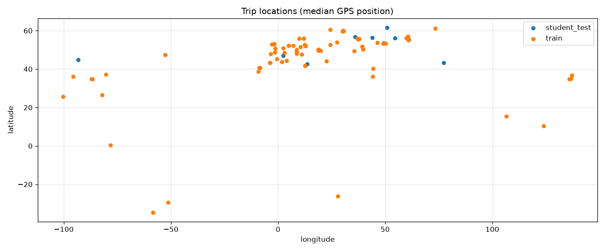<figcaption>Figure 1. Trip locations (median GPS position) for TRAIN and student-test (source: scripts/01_explore.py).</figcaption></figure>

**How reference labels are used safely.** `.route` lists arcs but not which fix lies on which arc. Per-fix training labels
are derived by a monotone dynamic-programming alignment of fixes to route positions (Section 5.5). This is done only for
TRAIN and student-test, and only *after* features have been computed. At inference time the loader `io.load_trip()` reads only
`.track/.nodes/.arcs`. The evaluator's `.route` files are read only by the server-side scoring step, after the prediction has finished.

**Reference-label quality.** Reference routes are treated as reference information, not perfect ground truth. In TRAIN the
fix-to-reference distance has median 5.7 m but a 95th percentile of
142 m, because a few routes do not cover the drive. Trip 00000054's route covers only part of a long drive,
and trip 00000033's route diverges from the GPS. Fixes farther than 30 m from their aligned reference arc are therefore marked
*unreliable* and excluded from fitting and cross-validation (87.5 % of TRAIN fixes are reliable). In student-test the 99th percentile is
28.1 m and all fixes are used.

## 5. Data Preprocessing

All preprocessing lives in the `pathsnap/` package. The same code runs for training and inference, and it has no fitted parameters.

### 5.1 GPS loading and cleaning (`io.py`, `preprocess.py`)
1. Parse with column-count checks; reject unreadable files.
2. Drop NaN, out-of-range and (0, 0) coordinates; stable-sort by timestamp; drop duplicated timestamps; keep the original row index.
3. Project into a **local metric plane**: an equirectangular projection on the WGS84 ellipsoid around the trip's median
   position, using the meridional radius $M$ and prime-vertical radius $N$ at the reference latitude $\varphi_0$:
   $x = (\lambda-\lambda_0)\,\tfrac{\pi}{180}\,N\cos\varphi_0$, $y = (\varphi-\varphi_0)\,\tfrac{\pi}{180}\,M$.
   For trip extents of a few tens of kilometres this is accurate to well under GPS noise; it is verified against haversine distances in the tests.
4. Kinematics: step distance and $\Delta t$, centred speed, and a robust heading whose window grows from ±1 to ±8 fixes until the
   displacement is at least 2 m (otherwise marked invalid). Outliers (>252 km/h) and gaps (>5 s) are flagged.

**Data-quality checks** (`io.validate_trip`, `network.full_graph_stats`) run on every trip:

| Check | TRAIN | Student-test |
|---|---|---|
| NaN / invalid coordinates | 0 / 0 | 0 / 0 |
| Non-increasing timestamps | 0 | 0 |
| Largest time gap | 153,064 s | 210 s |
| Trips with a gap > 30 s | 28 | 2 |
| Speed-outlier fixes (flagged) | 149 | 1 |
| Isolated nodes / invalid route ids | 0 / 0 | 0 / 0 |
| Reference arcs lost by network cropping | 0 | 0 |

*Source: `reports/eda_summary.json`.*

<figure>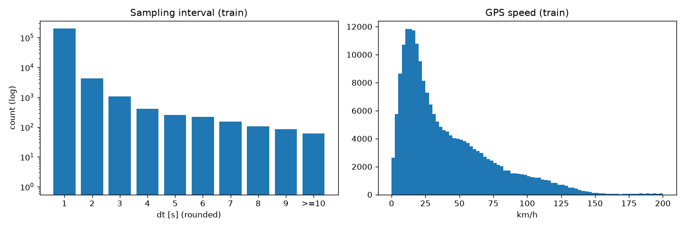<figcaption>Figure 2. Sampling interval and GPS speed distributions (TRAIN).</figcaption></figure>

### 5.2 Road-network construction (`network.py`)
The network is cropped to the GPS bounding box plus 1000 m. This removed no reference arc,
as the table above shows. Nodes are re-indexed and projected. For each arc the code computes length, bearing, in- and out-degree and a
reverse-twin lookup. A directed adjacency list supports a bounded, memoised Dijkstra search, and a shortest-path routine fills route gaps.

### 5.3 Candidate generation and spatial filtering
Every arc is densified into points 10 m apart and indexed in a SciPy **KD-tree**. For each fix,
a radius query of 50 m returns nearby arcs. Exact point-to-segment distances are computed, and the
12 nearest arcs are kept; if none is in range, the nearest arc is kept as a fallback. The radius and
*K* were chosen from TRAIN statistics: in student-test, 99.9 % of reference arcs lie within the 12 nearest arcs.

| Candidate statistics | TRAIN | Student-test |
|---|---|---|
| Candidate rows (fix × arc) | 1,360,924 | 146,913 |
| Candidates per fix | 6.53 | 7.67 |
| Reference arc missing from candidates (all fixes) | 11.33 % | 0.21 % |
| … among fixes with reliable labels | 0.18 % | n/a (all used) |

*Source: `reports/candidate_stats_*.csv`, `cache/obs_*.parquet`.*

### 5.4 The 28 engineered features (`features.py`)

| Group | Features | Rationale |
|---|---|---|
| Distance | `dist`, `dist_rank`, `dist_minus_min`, `dist_ratio`, `n_cands` | closeness to the fix, absolute and relative to the other candidates |
| Direction | `heading_diff`, `cos_heading`, `heading_valid`, `heading_rank`, `wide_heading_diff` | separates two-way twin arcs; a ±5-fix window adds robustness at low speed |
| Kinematics | `speed`, `dt_prev`, `step_prev` | sampling and motion context |
| Arc geometry | `arc_length`, `proj_t`, `dist_to_arc_end` | where along the arc the fix projects |
| Topology | `has_reverse`, `to_out_deg`, `from_in_deg` | two-way roads and junction complexity |
| Temporal context | `ctx_dist_mean`, `ctx_dist_max`, `ctx_dist_rank` | distance of the ±3 neighbouring fixes to the same arc |
| Connectivity | `prev_connected`, `next_connected` | whether the arc connects to the neighbouring fixes' nearest arcs |
| Transition consistency | `trans_dev_prev`, `trans_reachable_prev`, `trans_dev_next`, `trans_reachable_next` | $\lvert d_{network} - d_{GPS} \rvert$ to the neighbours' nearest arcs (bounded Dijkstra) |

No feature uses the reference route. A test recomputes features for a trip after deleting its `.route` file and asserts that
they are identical.

### 5.5 Training-label alignment (`labels.py`, TRAIN and student-test only)
Fix $i$ is assigned to a route position $j$, with positions non-decreasing, by minimising the total point-to-arc distance:
$C[i,j] = d(z_i, r_j) + \min_{k \le j} C[i-1,k]$. A row-wise prefix minimum makes this $O(T\cdot M)$. Using route *positions*
rather than arc ids handles routes that revisit an arc. A candidate row is labelled $y=1$ if it is the aligned arc.

<figure>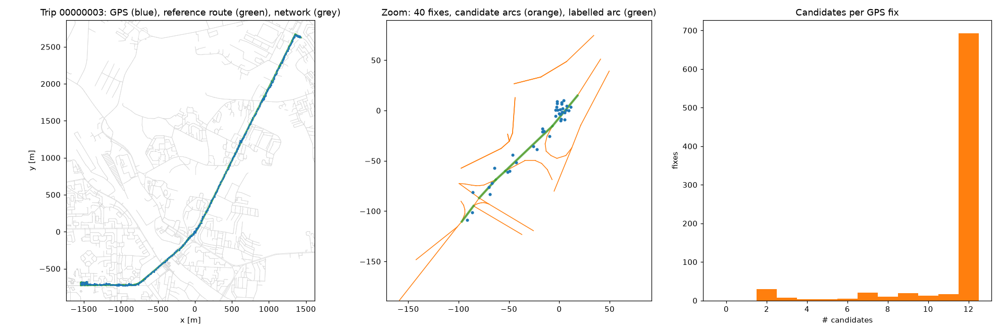<figcaption>Figure 3. Preprocessing of TRAIN trip 00000003: GPS fixes (blue) on the reference route (green) and network (grey); zoom on candidate arcs (orange) and the labelled arc (green); candidates per fix (source: scripts/demo_preprocessing.py).</figcaption></figure>


<figure>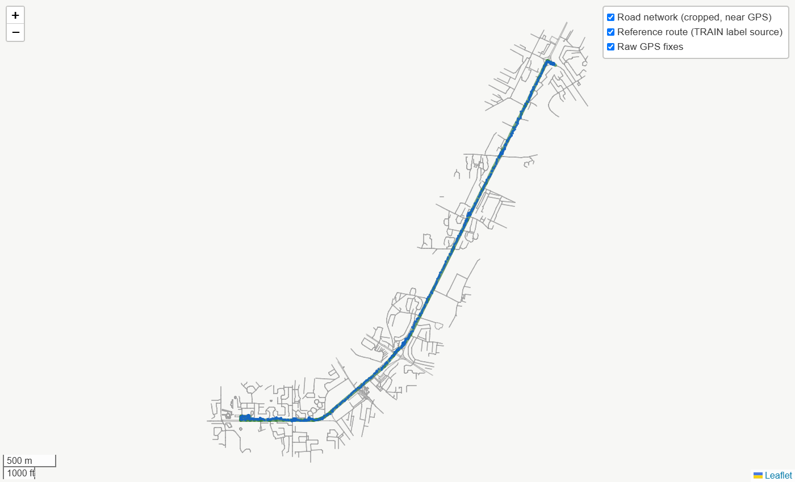<figcaption>Figure 4. Offline Folium map of the same trip: GPS fixes, nearby road network and reference route (no external tiles).</figcaption></figure>

## 6. Machine Learning Methodology

**Formulation.** Map matching is cast as **binary candidate classification**: for each (fix, candidate arc) row, predict
$P(y=1 \mid \mathbf{x})$, the probability that this arc is the driven road. The arg-max over a fix's candidates gives the
classifier-only match, and the probabilities become HMM emission scores. Every model therefore must produce probabilities.
Eight models from six families were compared, so that the choice rests on evidence rather than habit:

| Model | Family | Configuration (initial) | Why considered |
|---|---|---|---|
| Logistic Regression | linear | standardised inputs, L2, C = 1 | interpretable baseline with calibrated probabilities |
| Gaussian Naive Bayes | probabilistic, generative | default variance smoothing | very fast; tests whether conditional independence suffices |
| Random Forest | bagging ensemble | 200 trees, min leaf 5, √features, 50 % bootstrap | non-linear interactions, robust to scaling |
| Extra Trees | randomised trees | 200 trees, min leaf 5, √features | lower variance than RF, fast training |
| HistGradientBoosting | boosting | 300 iterations, 31 leaves, learning rate 0.1 | histogram GBDT in scikit-learn |
| LightGBM | boosting | 400 trees, 63 leaves, learning rate 0.05, subsampling | efficient leaf-wise boosting |
| XGBoost | boosting | 400 trees, depth 7, learning rate 0.05, subsampling | regularised depth-wise boosting, strong on tabular data |
| MLP (64-32) | neural network | 2 hidden layers, Adam, early stopping | non-linear representation learning |

*Source: `pathsnap/models.py`.* Boosted trees suit this problem because the features are heterogeneous and strongly interacting.
For example, a small distance matters only if the heading is consistent. The linear and naive-Bayes models test how far simpler
assumptions go. All models were trained on identical rows and folds.

## 7. Model Training and Validation

**Data.** Training uses only the 80 TRAIN trips: 182,350 reliable-label fixes, giving
1,291,898 candidate rows.

**Grouped cross-validation.** `GroupKFold(n_splits=5)` groups rows by `trip_id`. Consecutive 1 Hz fixes of a trip are
highly correlated, so random row-wise splits would leak near-duplicates into validation and inflate scores. With trip
grouping every validation fold contains only trips the model has never seen; a test asserts that the folds are disjoint and cover every trip.

**Pipeline** (`scripts/03_train_models.py`): for each model and each fold, fit on the training folds and predict
probabilities on the held-out trips. Metrics are computed from those predictions, together with training-fold metrics for
diagnosing over-fitting. Each model is then refit on all TRAIN rows and saved.

**Metrics.**
- *Top-1 accuracy* (primary): the fraction of fixes whose highest-probability candidate is the reference arc. The denominator counts all evaluated fixes, so candidate misses count as errors.
- *Macro-F1*, *precision* and *recall*: computed at candidate level (threshold 0.5) and averaged over both classes.
- *Log loss*: measures probability calibration, which matters because the probabilities feed the HMM.
- *Route continuity*: the share of arc changes between consecutive fixes that are directly connected.
- *Timing*: training and inference time.

**Selection criterion.** The criterion, fixed before results were seen, was the highest mean cross-validated top-1 accuracy on TRAIN.
Ties within fold noise were resolved by probability quality (log loss) and inference speed. Student-test results were never consulted for any choice.

## 8. Eight-Model Comparison

| Model | Family | CV top-1 accuracy | Fold std | CV macro-F1 | CV log loss | Training time (s) | Inference (ms / fix) | Status |
|---|---|---|---|---|---|---|---|---|
| **XGBoost** | Boosting (XGBoost) | 91.27 % | ± 1.35 % | 0.9468 | 0.0681 | 19.2 | 0.0069 | **Selected (final)** |
| LightGBM | Boosting (LightGBM) | 91.20 % | ± 1.37 % | 0.9466 | 0.0692 | 44.0 | 0.1125 | Not selected |
| Random Forest | Ensemble (bagging) | 91.10 % | ± 1.26 % | 0.9458 | 0.0699 | 79.9 | 0.0197 | Not selected |
| Extra Trees | Ensemble (randomised trees) | 90.78 % | ± 1.21 % | 0.9430 | 0.0743 | 52.9 | 0.0325 | Not selected |
| MLP (64-32) | Neural network (MLP) | 90.75 % | ± 1.24 % | 0.9411 | 0.0804 | 102.9 | 0.0022 | Not selected |
| HistGradientBoosting | Boosting (histogram GBDT) | 90.70 % | ± 1.23 % | 0.9440 | 0.0821 | 13.9 | 0.0189 | Not selected |
| Logistic Regression | Linear / probabilistic | 88.78 % | ± 1.17 % | 0.9212 | 0.1074 | 2.3 | 0.0010 | Not selected |
| Gaussian Naive Bayes | Probabilistic (generative) | 85.59 % | ± 1.52 % | 0.8543 | 0.7037 | 0.3 | 0.0023 | Not selected |
| *Nearest road (baseline)* | geometric, no learning | 56.09 % | – | n/r | n/r | – | – | reference |

*Table 1. TRAIN 5-fold GroupKFold results (mean over folds). Source: `reports/experiments/model_comparison.csv`.
Training time is a single fit on all TRAIN rows. The slower models were measured while other jobs shared the CPU, so their times
are indicative only. Inference time is classifier scoring per GPS fix. n/r = not recorded.*

<figure>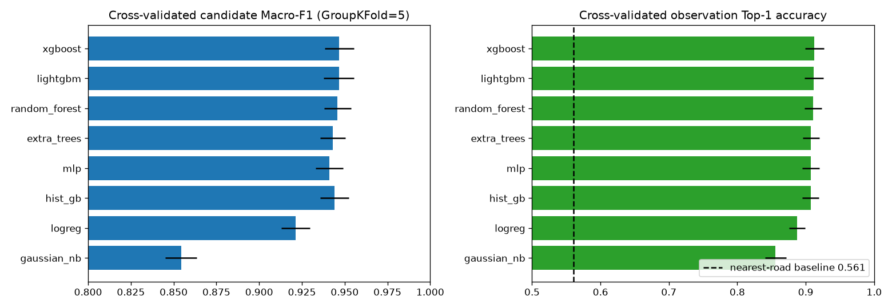<figcaption>Figure 5. Cross-validated macro-F1 (left) and top-1 accuracy (right) with fold standard deviation; dashed line is the nearest-road baseline.</figcaption></figure>


<figure>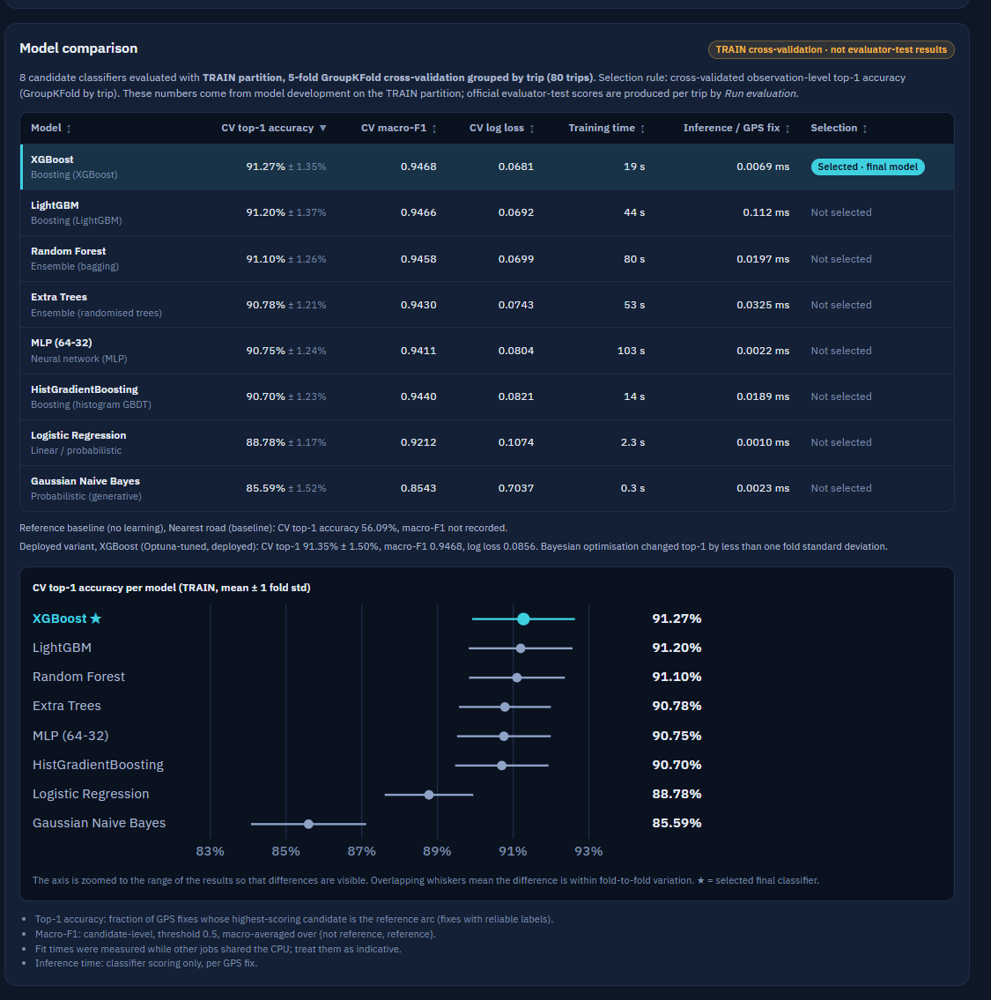<figcaption>Figure 6. The same comparison as shown in the evaluator dashboard (served by GET /models/comparison): mean ± 1 fold std on a labelled zoomed axis.</figcaption></figure>

**Per-fold top-1 accuracy (TRAIN):**

| Model | Fold 0 | Fold 1 | Fold 2 | Fold 3 | Fold 4 | Train-fold top-1 |
|---|---|---|---|---|---|---|
| XGBoost | 88.76 % | 92.82 % | 91.28 % | 91.65 % | 91.85 % | 95.20 % |
| LightGBM | 88.63 % | 92.73 % | 91.34 % | 91.50 % | 91.78 % | 95.55 % |
| Random Forest | 88.78 % | 92.48 % | 90.91 % | 91.55 % | 91.77 % | 95.16 % |
| Extra Trees | 88.57 % | 91.95 % | 90.47 % | 91.29 % | 91.63 % | 94.67 % |
| MLP (64-32) | 88.46 % | 92.15 % | 90.87 % | 90.86 % | 91.41 % | 93.10 % |
| HistGradientBoosting | 88.35 % | 91.95 % | 90.92 % | 90.93 % | 91.34 % | 94.28 % |
| Logistic Regression | 86.75 % | 89.10 % | 88.32 % | 90.04 % | 89.67 % | 88.93 % |
| Gaussian Naive Bayes | 85.71 % | 87.50 % | 86.85 % | 84.64 % | 83.27 % | 85.73 % |

*Table 2. Source: `reports/experiments/cv_folds.csv`.*

**Why XGBoost.** XGBoost has the highest mean CV top-1 accuracy (91.27 %), the best
macro-F1 (0.9468), the lowest log loss (0.0681) and
fast inference. **The top models are, however, statistically indistinguishable.** LightGBM (91.20 %)
and Random Forest (91.10 %) are within 0.17
percentage points, far less than the fold standard deviation of about 1.3 pp. The choice is therefore driven as much by calibration and speed as by accuracy.

**Observations.**
- **Fit.** The tree ensembles fit their training folds clearly better than the validation folds, showing moderate over-fitting
  (Random Forest 95.16 % vs 91.10 %). The linear and
  naive-Bayes models show almost no gap and lower scores, which indicates under-fitting.
- **Calibration.** Gaussian NB's log loss (0.7037) is an order of magnitude worse, because the
  independence assumption makes it over-confident.
- **Variation between trips.** Fold 0 is hardest for every model, so the difficulty varies by trip as well as by algorithm.

<figure>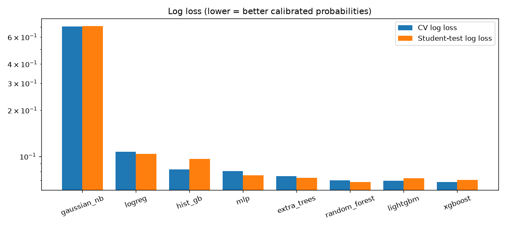<figcaption>Figure 7. Log loss per model (log scale; CV and student-test).</figcaption></figure>


<figure>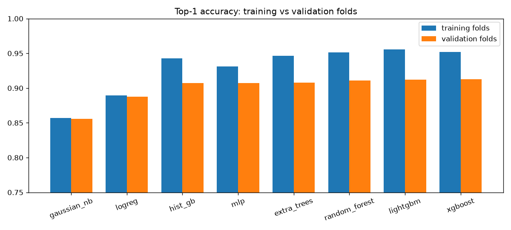<figcaption>Figure 8. Training-fold versus validation-fold top-1 accuracy (over-/under-fitting diagnostic).</figcaption></figure>

## 9. Bayesian Hyperparameter Optimisation

**Why Optuna.** Optuna's Tree-structured Parzen Estimator (TPE) models good and bad regions of the search space and proposes
promising configurations. This is far more sample-efficient than grid search when each trial costs a full 5-fold cross-validation.

**Set-up** (`scripts/04_bayes_opt.py`, TRAIN only):

| Item | Value |
|---|---|
| Sampler | TPE(seed=42, n_startup_trials=10) |
| Objective | mean GroupKFold(5) observation-level top-1 accuracy (train partition) (maximised) |
| Budget | 50-minute timeout; **22 trials completed** (3,155 s); every trial is stored in SQLite (`artifacts/optuna/xgboost.db`) and `optuna_xgboost_trials.csv` |
| Cost control | trials fit on every second fix of the training folds (1 Hz fixes are redundant) and validate on all fixes; the final configuration is refit on all rows |

| Hyperparameter | Search range | Best value (trial 1) |
|---|---|---|
| `n_estimators` | 100–1000 (step 50) | 900 |
| `learning_rate` | 0.01–0.2 (log) | 0.0605 |
| `max_depth` | 3–12 | 10 |
| `min_child_weight` | 0.5–50 (log) | 0.550 |
| `subsample` | 0.5–1.0 | 0.985 |
| `colsample_bytree` | 0.4–1.0 | 0.899 |
| `reg_lambda` | 0.001–10 (log) | 0.0071 |

*Source: `reports/experiments/optuna_xgboost_best.json`. Best objective value (half-data trials): 91.30 %.*

**Default vs tuned XGBoost** (identical full-data folds and partitions):

| Variant | CV top-1 (± std) | CV macro-F1 | CV log loss | Student-test top-1 | Student-test macro-F1 | Student-test log loss | Training time | Inference |
|---|---|---|---|---|---|---|---|---|
| XGBoost, default configuration | 91.27 % ± 1.35 % | 0.9468 | 0.0681 | 89.82 % | 0.9393 | 0.0704 | 19.2 s | 0.0069 ms |
| **XGBoost, Optuna-tuned (deployed)** | **91.35 %** ± 1.50 % | 0.9468 | 0.0856 | 89.26 % | 0.9367 | 0.0912 | 63.2 s | 0.0247 ms |

*Table 3. Source: `reports/experiments/tuned_vs_untuned.csv`.*

**Interpretation.** Tuning raised CV top-1 accuracy by only
0.07 pp, which is well inside the fold
standard deviation. It also **worsened calibration** (log loss 0.0681 → 0.0856)
and made training and inference about three times slower. The tuned model was kept because the selection rule fixed in advance
(best CV top-1 on TRAIN) prefers it. Changing the rule after seeing held-out results would be selection bias. On student-test the
tuned model is slightly *worse*; this is reported, not acted upon. The HMM decoder later compensates for the over-confident
probabilities through a small emission weight (Section 10).

<figure>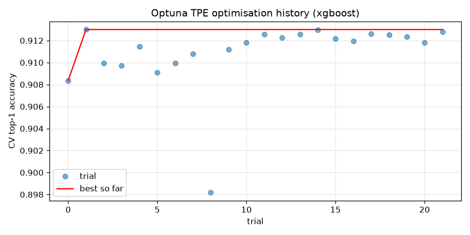<figcaption>Figure 9. Optuna optimisation history (each trial and best-so-far CV top-1).</figcaption></figure>


<figure>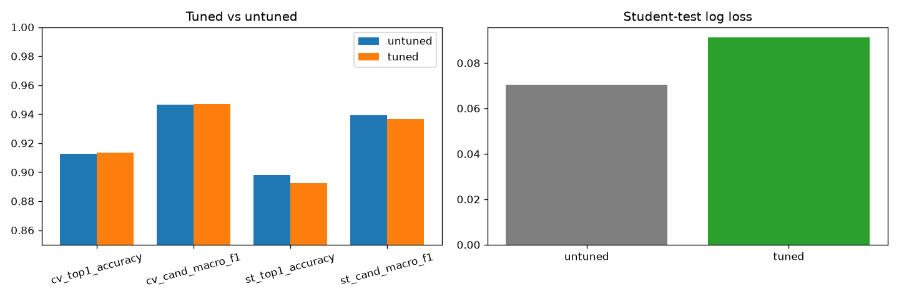<figcaption>Figure 10. Default versus tuned XGBoost (CV and student-test) and student-test log loss.</figcaption></figure>

## 10. Hidden Markov Model and Viterbi Decoding

**Why independent predictions are insufficient.** The classifier scores each fix in isolation. Consecutive fixes can then be assigned to
unconnected arcs, or flip between twin directions. On student-test the classifier-only sequence contains
146 arc changes that are unreachable within 500 m through the
directed network.

**Model** (`pathsnap/hmm.py`). The hidden state at time $t$ is a candidate arc $c$ of fix $t$, together with its projected position on the arc.

* **Emission:** $\log P(z_t \mid c) = w_e \cdot \log \dfrac{p_{t,c}}{\sum_{c'} p_{t,c'}}$, where $p$ is the XGBoost
  probability, normalised over the fix's candidates. An optional Gaussian distance term was available, but tuning set it to zero.
* **Transition:** $\log P(c_t \to c_{t+1}) = -\dfrac{\lvert d_{\text{net}} - d_{\text{GPS}} \rvert}{\beta} - \rho\,[c_{t+1} = \text{reverse}(c_t)]$.
  Here $d_{\text{net}}$ is the **directed** network distance between the projected positions (bounded Dijkstra; forward moves on
  the same arc are direct), $d_{\text{GPS}}$ is the straight-line displacement between the fixes, and $\rho$ penalises U-turns onto
  the reverse twin arc. Unreachable pairs get $-\infty$.
* **Viterbi recurrence:** $V_{t+1}(b) = E_{t+1}(b) + \max_a \left[ V_t(a) + T(a,b) \right]$, with back-pointers. The best final state is
  backtracked to give one arc per fix.
* **Breaks and gaps:** if no finite transition exists (disconnected network parts, dead ends) or a gap exceeds
  600 s, the chain restarts with a penalty. The Dijkstra search radius grows with the time gap.
* **Route reconstruction:** the per-fix arc sequence is compressed, and consecutive non-adjacent arcs are joined with the
  directed shortest path (`reconstruct_route`).

**TRAIN-only tuning** (`scripts/06_tune_decoder.py`). The emissions came from **out-of-fold** probabilities of the final model on
24 seeded TRAIN trips, so the decoder saw realistic test-time scores. Optuna ran 30 trials
(199 s). The parameters were selected on TRAIN accuracy, and student-test was used only as confirmation.

| Decoder parameter | Search range | Final value |
|---|---|---|
| β (transition scale, m) | 1–100 (log) | 22.28 |
| emission weight $w_e$ | 0.2–3 (log) | 0.215 |
| σ (Gaussian distance term) | {0, 5, 10, 20, 40} | 0 (off) |
| same-arc backward tolerance (m) | 2–30 | 26.7 |
| break penalty | 5–200 (log) | 26.8 |
| U-turn (reverse-arc) penalty ρ | 0–10 | 7.35 |

| TRAIN out-of-fold (24 trips) | Accuracy |
|---|---|
| XGBoost only | 90.42 % |
| + HMM, default parameters | 92.06 % |
| + HMM, tuned parameters | **93.49 %** |

*Source: `reports/experiments/hmm_tuning.json`, `artifacts/final/hmm_params.json`.* The small emission weight
(0.215) means the decoder relies more on network consistency than on the over-confident classifier
probabilities, which matches the calibration finding of Section 9.

<figure>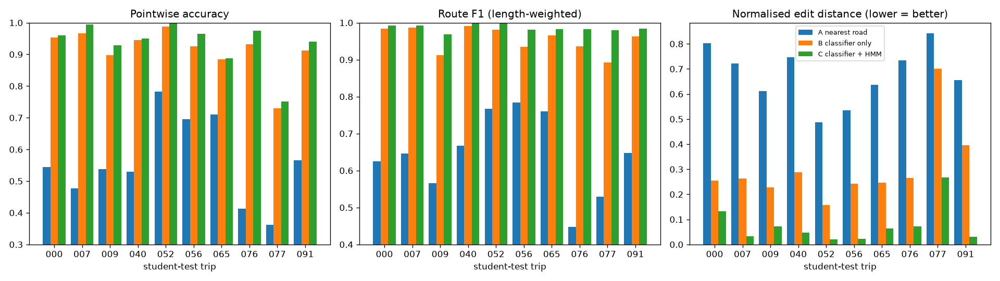<figcaption>Figure 11. Student-test: nearest road (A), XGBoost only (B) and XGBoost + HMM (C) per trip: pointwise accuracy, route F1 and normalised edit distance.</figcaption></figure>


<figure>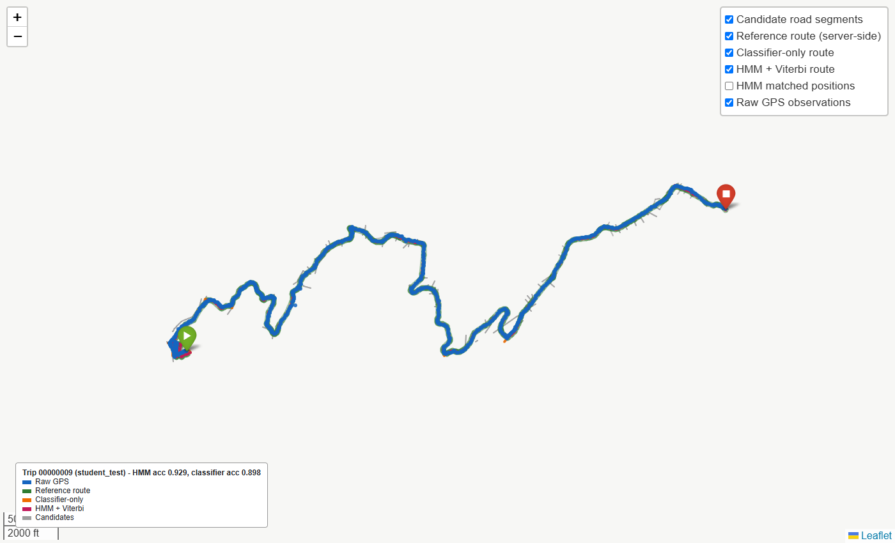<figcaption>Figure 12. Folium map of student-test trip 00000009 generated by the pipeline: raw GPS, candidate roads, reference route (server-side only), classifier-only and HMM routes (offline, no tiles).</figcaption></figure>

## 11. System Architecture

<figure>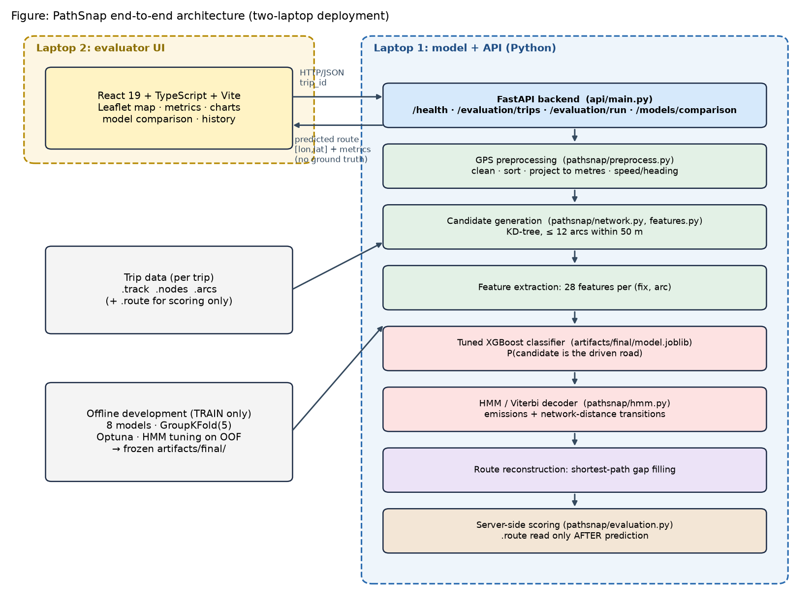<figcaption>Figure 13. End-to-end architecture and two-laptop deployment.</figcaption></figure>

**Request flow.**
1. The React dashboard sends `POST /evaluation/run {"trip_id"}`.
2. FastAPI loads the trip's `.track/.nodes/.arcs`.
3. The pipeline runs: preprocessing → candidates → 28 features → tuned XGBoost → HMM/Viterbi → route reconstruction.
4. The server then reads the reference route and computes metrics.
5. The response contains the predicted route as `[lon, lat]` segments, the per-fix matches, the metrics and the timings. It contains no ground truth.

**Two-laptop deployment.** Laptop 1 runs the backend and model (Uvicorn on `0.0.0.0:8000`); Laptop 2 runs the Vite production
build of the UI and calls Laptop 1 over Wi-Fi. CORS allows any origin without credentials. The connection was verified
in practice: Laptop 2 (10.20.205.106) called `/health`, `/evaluation/trips` and `POST /evaluation/run` on Laptop 1, and all returned
HTTP 200 (`logs/demo_backend.log`).

## 12. Backend Implementation

**Stack.** Python 3.11, FastAPI, Uvicorn, Pydantic. The trained bundle is loaded once at start-up by
`pathsnap.pipeline.MapMatcher.load()`, which checks that the stored feature schema equals the code's feature list.

| Module | Responsibility |
|---|---|
| `pathsnap/io.py` | parsing, validation, partition resolution; `load_trip` never reads `.route` |
| `pathsnap/preprocess.py`, `geo.py` | cleaning, projection, kinematics |
| `pathsnap/network.py` | cropped network, KD-tree index, bounded Dijkstra, shortest paths |
| `pathsnap/features.py` | candidate generation and the 28 features |
| `pathsnap/models.py` | the 8-model zoo |
| `pathsnap/hmm.py` | HMM/Viterbi decoding and route reconstruction |
| `pathsnap/pipeline.py` | `MapMatcher`: the only prediction path (used by scripts and the API) |
| `pathsnap/evaluation.py`, `labels.py`, `metrics.py` | server-side scoring after prediction |
| `api/main.py`, `service.py`, `schemas.py` | endpoints, prediction and evaluation services, Pydantic schemas |

| Endpoint | Purpose |
|---|---|
| `GET /health` | status, model name, partition served, whether the fallback is active, number of trips |
| `GET /evaluation/trips` | trip ids with observation count and duration (never routes or labels) |
| `POST /evaluation/run` | full pipeline plus server-side scoring for one trip |
| `GET /evaluation/{id}` | stored result (in memory) |
| `GET /evaluation/{id}/map` | Folium HTML of the run (no reference route) |
| `GET /models/comparison` | recorded TRAIN cross-validation comparison (read-only) |

**Response format.**
- Coordinates follow GeoJSON order `[lon, lat]`, fractions lie in [0, 1], times are in milliseconds (`*_ms`), and trip ids are zero-padded strings.
- `metrics` holds the classifier + HMM metrics; `classifier_only_metrics` and `nearest_road_metrics` hold the comparisons.
- The contract was proposed by the frontend developer (`docs/API_CONTRACT.md`) and implemented by the backend.

**Error handling.**
- Errors use FastAPI's `{"detail": …}` with 404 (unknown trip or evaluation), 422 (invalid body), 503 (model not loaded) and 500 (pipeline failure).
- If `PATHSNAP_EVAL_DIR` is set but missing or incomplete, the server **refuses to start**; it never silently serves another partition.
- Every request is logged with client IP, path, status and latency, and every run logs `RUN` and `DONE` lines with the metrics.

## 13. Frontend Implementation

**Stack.** React 19, TypeScript 5.9, Vite 8, Leaflet/react-leaflet; tests with Vitest and Testing Library. All backend calls go
through a single client module (`api/client.ts`). A runtime validator (`api/validate.ts`) rejects responses that do not
match the contract, so a malformed response is never shown as a success.

**Dashboard features.**
- Connection panel with health polling; the backend address can come from the UI, a `?api=` URL parameter or `.env`.
- Trip selector listing the 10 evaluation trips.
- Interactive Leaflet map: raw GPS observations (amber), the predicted route (cyan) and the nearby road network, with a layer control.
- Metric cards (top-1, macro-F1, continuity, log loss, inference time, HMM status) and an additional-metrics table.
- Charts: route quality, *Effect of HMM/Viterbi decoding* (classifier-only vs classifier + HMM) and a server timing breakdown.
- A **Model comparison** section: a sortable table of the 8 models (XGBoost highlighted) and a dot plot with fold-std whiskers, clearly labelled
  *TRAIN cross-validation · not evaluator-test results*.
- Session history, a cross-trip chart, and a second tab with the server-rendered Folium map.

<figure>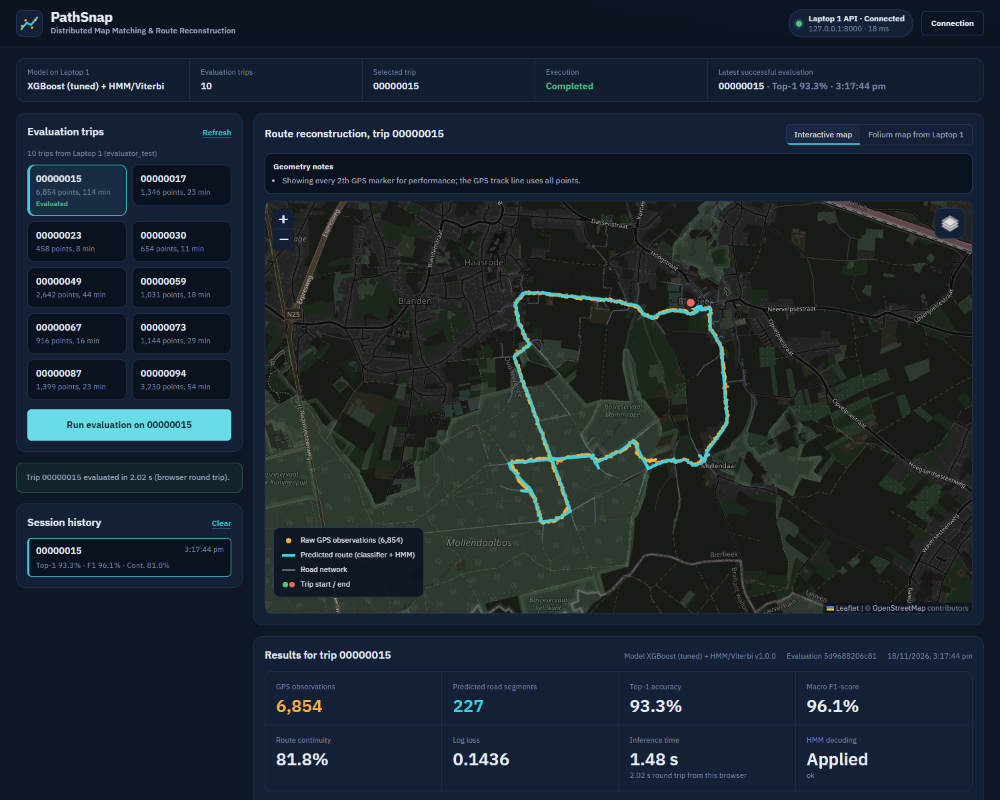<figcaption>Figure 14. Dashboard after evaluating official evaluator trip 00000015 (6,854 fixes): predicted route (cyan) over GPS (amber); metrics from Laptop 1.</figcaption></figure>


<figure>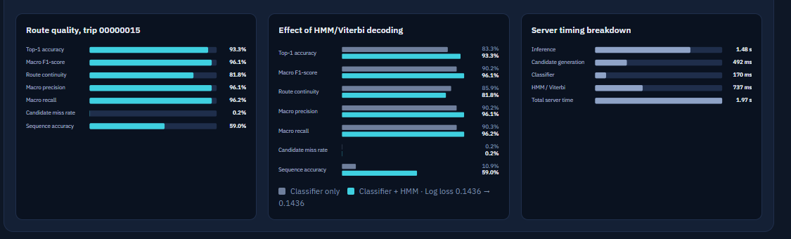<figcaption>Figure 15. Dashboard charts for evaluator trip 00000015, including the effect of HMM/Viterbi decoding versus classifier-only.</figcaption></figure>

## 14. Official Evaluator Integration

**Folder.** `evaluator_test/` contains 10 trip folders (`00000015` … `00000094`), each holding `.track/.nodes/.arcs/.route`.
There are **no** scripts, README or metric definitions. The "evaluator" is the reserved data partition, and scoring is
performed by our API ("the API calculates prediction accuracy using its internal reference data", hackathon guidelines).
The trip ids are disjoint from TRAIN and student-test, and the input files passed validation (no NaN, ordered timestamps, valid node references).

**Loading.** The backend is started with `PATHSNAP_EVAL_DIR=<repo>\evaluator_test`. `/health` then reports
`evaluation_partition = evaluator_test` with no fallback, and `/evaluation/trips` lists exactly the 10 ids.

**Frozen model.** The bundle `artifacts/final/` (model SHA-256 prefix `7ebb199fc9b56a3d`) was hashed before and after
the evaluation and was unchanged. No training, tuning or selection used evaluator data.

**Scoring.** For each request the prediction is completed first, from `.track/.nodes/.arcs` only. The server then aligns the reference
route to the fixes and computes the metrics. Only aggregate metrics and the *predicted* route are returned.

**Leakage prevention (verified by tests).**
- No prediction module imports the label code (static analysis test).
- A runtime file-access spy shows that prediction opens no `.route` file, and that scoring does.
- Predictions are byte-identical whether or not the `.route` file exists.
- The test suite cannot read evaluator data even if `PATHSNAP_EVAL_DIR` is set; a guard in `tests/conftest.py` blocks it.
- No training or tuning script references the evaluator partition.

**CV vs evaluator metrics.** TRAIN CV top-1 is a *classifier-only* score on reliable-label fixes of validation folds. Evaluator
metrics are computed on *all* fixes of unseen trips, for the full classifier + HMM system. The two measure different things and
are reported separately.

## 15. Results and Performance Analysis

### 15.A TRAIN cross-validation (development)
See Table 1. XGBoost reached a CV top-1 accuracy of 91.27 % ± 1.35 %,
against 56.09 % for nearest road. With the HMM on out-of-fold TRAIN predictions, accuracy was 93.49 % (24 trips).

### 15.B Student-test confirmation (10 trips, 19,160 fixes)

| Metric | A: nearest road | B: XGBoost only | C: XGBoost + HMM/Viterbi |
|---|---|---|---|
| Pointwise accuracy (fix-weighted) | 53.18 % | 89.26 % | **91.55 %** |
| Macro-F1 (fix-weighted) | 0.7239 | 0.9391 | **0.9523** |
| Accuracy, either travel direction (fix-weighted) | 89.12 % | 94.96 % | **96.87 %** |
| Accuracy (mean over trips) | 56.20 % | 91.34 % | **93.53 %** |
| Strict continuity (mean) | 44.74 % | 83.84 % | **89.75 %** |
| Network-reachable continuity (mean) | 87.97 % | 97.81 % | **99.88 %** |
| Sequence accuracy (mean) | 32.26 % | 69.56 % | **92.39 %** |
| Route precision, length-weighted (mean) | 54.29 % | 93.48 % | **97.58 %** |
| Route recall, length-weighted (mean) | 79.88 % | 97.67 % | **99.65 %** |
| Route F1, length-weighted (mean) | 64.42 % | 95.46 % | **98.60 %** |
| Edit distance (mean, arcs) | 423.4 | 147.8 | **25.5** |
| Unreachable transitions (total) | 709 | 146 | **3** |
| Mean deviation from reference route (m) | 1.1 | 0.4 | **0.3** |

*Table 4. Source: `reports/experiments/route_eval_student_test_summary.json`.*

| Trip | GPS fixes | A nearest | B XGBoost | C XGB+HMM | Route F1 B | Route F1 C | Seq. acc. C |
|---|---|---|---|---|---|---|---|
| 00000000 | 2,503 | 54.5 % | 95.4 % | **95.9 %** | 98.3 % | 99.2 % | 86.8 % |
| 00000007 | 1,354 | 47.7 % | 96.6 % | **99.5 %** | 98.7 % | 99.3 % | 96.7 % |
| 00000009 | 1,049 | 53.8 % | 89.8 % | **92.9 %** | 91.3 % | 96.8 % | 92.8 % |
| 00000040 | 2,995 | 53.0 % | 94.6 % | **95.0 %** | 99.0 % | 99.8 % | 95.4 % |
| 00000052 | 262 | 78.2 % | 98.9 % | **100.0 %** | 98.1 % | 99.8 % | 97.9 % |
| 00000056 | 3,958 | 69.6 % | 92.5 % | **96.5 %** | 93.5 % | 98.1 % | 97.7 % |
| 00000065 | 768 | 71.1 % | 88.4 % | **88.8 %** | 96.6 % | 98.3 % | 93.5 % |
| 00000076 | 1,486 | 41.3 % | 93.1 % | **97.5 %** | 93.6 % | 98.2 % | 92.7 % |
| 00000077 | 3,911 | 36.2 % | 73.0 % | **75.2 %** | 89.2 % | 98.0 % | 73.2 % |
| 00000091 | 874 | 56.6 % | 91.2 % | **94.1 %** | 96.2 % | 98.4 % | 97.0 % |

*Table 5. Per-trip student-test results. Source: `reports/experiments/route_eval_student_test.csv`. The HMM improved accuracy on
10 of 10 trips (gain +0.39 to +4.37 pp).*

### 15.C Official evaluator-test (10 trips, 19,674 fixes, frozen system, each trip evaluated once)

| Metric | A: nearest road | B: XGBoost only | C: XGBoost + HMM/Viterbi |
|---|---|---|---|
| Pointwise top-1 accuracy (fix-weighted) | 50.91 % | 91.66 % | **95.96 %** |
| Macro-F1 (fix-weighted) | 0.7140 | 0.9520 | **0.9771** |
| Top-1 accuracy (mean over trips) | 54.43 % | 93.97 % | **96.30 %** |
| Macro-F1 (mean over trips) | 0.7357 | 0.9660 | **0.9794** |
| Strict continuity (mean) | 46.62 % | 82.69 % | **86.44 %** |
| Network-reachable continuity (mean) | 92.15 % | 98.32 % | **100.00 %** |
| Sequence accuracy (mean) | 30.72 % | 71.16 % | **89.30 %** |
| Route F1, length-weighted (mean) | 63.77 % | 92.68 % | **98.29 %** |
| Normalised edit distance (mean, lower is better) | 0.6928 | 0.2884 | **0.1070** |
| Unreachable transitions (total) | 381 | 67 | **0** |
| Mean deviation from reference route (m) | 0.9 | 0.3 | **0.2** |

*Table 6. Source: `reports/evaluator/evaluator_results.json`. Mean candidate miss rate: 0.22 %.*

| Trip | GPS fixes | A nearest | B XGBoost | C XGB+HMM | Macro-F1 (C) | Route prec. (C) | Route rec. (C) | Route F1 (C) | Strict cont. (C) | Seq. acc. (C) | Cand. miss | Inference (ms) | Round trip (ms) |
|---|---|---|---|---|---|---|---|---|---|---|---|---|---|
| 00000015 | 6,854 | 41.6 % | 83.3 % | **93.3 %** | 0.9612 | 83.3 % | 99.1 % | 90.5 % | 81.8 % | 59.0 % | 0.18 % | 1,438 | 2,004 |
| 00000017 | 1,346 | 45.6 % | 94.6 % | **96.3 %** | 0.9814 | 97.6 % | 99.8 % | 98.7 % | 73.5 % | 92.6 % | 0.74 % | 1,145 | 1,854 |
| 00000023 | 458 | 40.4 % | 94.3 % | **95.2 %** | 0.9718 | 95.3 % | 100.0 % | 97.6 % | 84.5 % | 61.5 % | 0.44 % | 261 | 306 |
| 00000030 | 654 | 61.3 % | 83.3 % | **88.8 %** | 0.9400 | 96.1 % | 99.0 % | 97.5 % | 77.6 % | 93.0 % | 0.61 % | 464 | 703 |
| 00000049 | 2,642 | 57.0 % | 99.4 % | **99.6 %** | 0.9974 | 100.0 % | 99.9 % | 99.9 % | 96.2 % | 99.8 % | 0.00 % | 880 | 1,289 |
| 00000059 | 1,031 | 51.7 % | 97.1 % | **97.6 %** | 0.9870 | 98.9 % | 100.0 % | 99.4 % | 80.5 % | 93.2 % | 0.19 % | 618 | 889 |
| 00000067 | 916 | 48.9 % | 96.8 % | **97.2 %** | 0.9832 | 100.0 % | 100.0 % | 100.0 % | 89.0 % | 100.0 % | 0.00 % | 251 | 310 |
| 00000073 | 1,144 | 72.8 % | 98.7 % | **98.9 %** | 0.9935 | 99.8 % | 100.0 % | 99.9 % | 96.1 % | 99.2 % | 0.00 % | 727 | 880 |
| 00000087 | 1,399 | 76.0 % | 96.9 % | **99.5 %** | 0.9971 | 100.0 % | 99.5 % | 99.8 % | 96.6 % | 99.8 % | 0.00 % | 1,080 | 1,662 |
| 00000094 | 3,230 | 48.9 % | 95.4 % | **96.7 %** | 0.9812 | 99.2 % | 99.7 % | 99.5 % | 88.8 % | 95.0 % | 0.00 % | 1,053 | 1,903 |

*Table 7. Per-trip evaluator-test results. Source: `reports/evaluator/evaluator_results.csv`. Inference = server-side prediction time;
round trip = complete `POST /evaluation/run`, including scoring. Strict cont. = share of arc changes between consecutive fixes that are directly connected.*

<figure>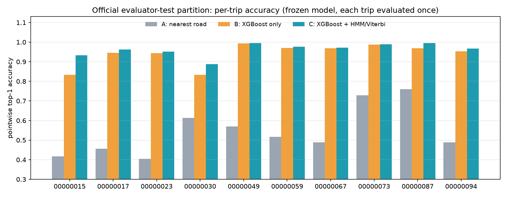<figcaption>Figure 16. Official evaluator-test: per-trip pointwise accuracy of nearest road (A), XGBoost only (B) and XGBoost + HMM (C).</figcaption></figure>


<figure>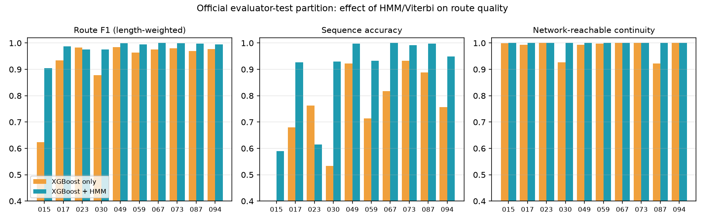<figcaption>Figure 17. Official evaluator-test: route F1, sequence accuracy and network-reachable continuity, XGBoost only vs XGBoost + HMM.</figcaption></figure>

**Analysis.**
- **Accuracy.** The HMM improved accuracy on **all 10 evaluator trips** (gain +0.17 to +10.04 pp).
  The largest gain was on the longest trip, 00000015.
- **Route coherence.** Unreachable transitions fall from 67 (classifier only) to
  0. Mean sequence accuracy rises from 71.2 % to 89.3 %.
- **Where the HMM did not improve everything.** On trip 00000015, strict continuity is *lower* with the
  HMM (81.8 % vs 85.9 %), even though accuracy and route F1 are higher.
  The same trip has the lowest sequence accuracy (59.0 %).
- **Evaluator vs student-test.** Evaluator-test accuracy is higher than student-test (96.0 % vs
  91.6 %). The two partitions contain different trips, and the difference should not be read as an
  improvement of the model, which is identical.

**Performance** (`reports/experiments/benchmark.json`, student-test, 16-core laptop, 15.8 GB RAM):
model load 2,057 ms; pipeline per trip 594 ms on average
(max 1,112 ms, 0.31 ms per fix); HMM 235 ms per trip;
API response 1,121 ms on average (max 3,586 ms);
peak memory 616 MB.
On evaluator-test: mean inference 792 ms, max 1,438 ms, mean round trip
1,180 ms, max 2,004 ms; peak server memory 666 MB.

## 16. Testing and Validation

All results below were produced by fresh runs on 18 November 2026. The raw output is stored in `reports/final/evidence/`.

| Suite | Result | What it covers |
|---|---|---|
| Python (pytest, 7 files) | **56 passed, 2 warnings in 32.93s** | parsing, preprocessing, geodesy, candidates, features, label alignment, HMM, metrics, every model's probability output, bundle reload in a fresh process, determinism, API endpoints and errors, CORS, GroupKFold separation, partition disjointness, leakage guards, refusal to start on a bad evaluator directory, the runtime `.route` access spy |
| Frontend (Vitest, 5 files) | **Tests  61 passed (61)** | API client, response validation, dashboard flows, history, model-comparison table (sorting, highlighting, missing values) |
| TypeScript check (`tsc --noEmit`) | **passed (exit 0)** | static types of the whole UI |
| Production build (`vite build`) | **passed** | bundling for deployment |
| API contract (real responses through the frontend validator) | **Tests  6 passed (6)** | real FastAPI JSON parsed by the unmodified frontend validator |
| Browser end-to-end (Playwright + Edge, production build) | **passed: all 8 checks** on all 10 evaluator trips | real UI → API → frozen model |

*Unit tests use synthetic data only for isolated cases. All result metrics come from real data.*

**End-to-end check results** (`reports/integration/e2e_summary_evaluator.json`): trip buttons loaded = True, routes drawn = True, top1 matches api = True, macro f1 matches api = True, route segments match api = True, history lists all runs = True, no console errors = True, no tile errors = True.
All map-tile HTTP responses returned 200. The browser recorded some `net::ERR_ABORTED` events; these are Leaflet cancelling tiles of the previous view and are not errors.

| Trip | Top-1 UI / API | Macro-F1 UI / API | Route segments UI / API | UI time |
|---|---|---|---|---|
| 00000015 | 93.3 % / 93.3 % | 96.1 % / 96.1 % | 227 / 227 | 2.43 s |
| 00000017 | 96.3 % / 96.3 % | 98.1 % / 98.1 % | 855 / 855 | 2.49 s |
| 00000023 | 95.2 % / 95.2 % | 97.2 % / 97.2 % | 96 / 96 | 0.93 s |
| 00000030 | 88.8 % / 88.8 % | 94.0 % / 94.0 % | 355 / 355 | 0.90 s |
| 00000049 | 99.6 % / 99.6 % | 99.7 % / 99.7 % | 409 / 409 | 1.92 s |
| 00000059 | 97.6 % / 97.6 % | 98.7 % / 98.7 % | 488 / 488 | 1.45 s |
| 00000067 | 97.2 % / 97.2 % | 98.3 % / 98.3 % | 82 / 82 | 0.89 s |
| 00000073 | 98.9 % / 98.9 % | 99.4 % / 99.4 % | 240 / 240 | 0.91 s |
| 00000087 | 99.5 % / 99.5 % | 99.7 % / 99.7 % | 454 / 454 | 2.46 s |
| 00000094 | 96.7 % / 96.7 % | 98.1 % / 98.1 % | 635 / 635 | 2.46 s |

*Table 8. The values displayed in the browser equal the API response exactly.*

**Final model verification.** The bundle reloads in a fresh process (`test_bundle_reloads_in_fresh_process_and_predicts`), and inference is deterministic.
The bundle's SHA-256 hashes were identical before and after evaluator use.

## 17. Challenges and Solutions

| Challenge (observed in this project) | Solution |
|---|---|
| Reference routes give no per-fix labels | monotone DP alignment of fixes to route positions (Section 5.5) |
| Some TRAIN reference routes do not cover the drive (e.g. trips 00000054, 00000033) | reliability filter (≤ 30 m); unreliable fixes excluded from fitting and CV |
| Twin arcs with identical geometry; ambiguity at junctions | heading features over two windows, transition-consistency features, U-turn penalty in the HMM |
| Independent predictions produce disconnected routes | HMM/Viterbi with directed network distances; shortest-path gap filling |
| Near-tied model ranking | pre-declared selection rule; calibration and speed as tie-breakers; honest reporting |
| Optuna tuning worsened calibration | decoder tuned on out-of-fold probabilities learned a small emission weight (0.215) |
| Large networks (up to 307 k arcs) and long trips | network cropping, KD-tree index, memoised bounded Dijkstra |
| Contract mismatch between the backend draft and the UI | backend re-shaped to the UI's contract; contract test with the real validator |
| Windows `OSError [Errno 22]` when re-saving a PNG open in a viewer | reproduced as a memory-mapped file; atomic writes with a timestamped fallback |
| OpenStreetMap tiles returned HTTP 403 for maps opened from disk | offline Folium maps drawing the road network instead of tiles |
| `localhost` resolving to IPv6 first (≈2 s delay per request) | documented use of `127.0.0.1` or the LAN IP |
| Silent fallback to student-test if the evaluator path is wrong | backend refuses to start when an explicit evaluator folder is invalid |
| Tests that could touch evaluator labels | test-suite guard blocking every evaluator path |
| Two-laptop Wi-Fi connectivity | binding to `0.0.0.0`, permissive CORS, firewall check; verified with a real Laptop 2 connection |

## 18. Limitations

* **Residual errors are mostly direction.** The undirected accuracy on student-test is 96.9 %
  against 91.6 % directed. The largest remaining error is choosing the reverse twin arc of the correct road.
* **The HMM does not improve every metric.** On evaluator trip 00000015 strict continuity is lower with the HMM; sequence
  accuracy varies widely between trips.
* **Optimisation gave no real gain.** Bayesian optimisation did not materially improve accuracy and worsened calibration.
* **Labels are a proxy.** Labels come from route alignment; some TRAIN reference routes are incomplete.
* **Performance trade-offs.** The tuned model is about 3× slower than the default configuration. Server-side scoring of long trips takes up to about 0.8 s
  in addition to inference. API memory grows to about 666 MB because the last 10 runs are kept for the map endpoint.
* **Generalisation.** The networks are per-trip and worldwide, but there are only 80 training trips. Behaviour on very different road types or
  sampling rates (e.g. 0.1 Hz) was not tested. There is no GPS smoothing.
* **Deployment.**
  - Offline batch processing per trip; no streaming.
  - In-memory result store.
  - The UI's map tiles need internet.
  - The firewall rule may need administrator rights.
  - Venue Wi-Fi client isolation could block the two-laptop set-up.

## 19. Future Scope

* **Real-time streaming:** online (fixed-lag) Viterbi over a sliding window for live tracking.
* **Larger networks:** a persistent spatial database (e.g. PostGIS) and precomputed contraction hierarchies for shortest paths.
* **Better sequence models:** jointly trained CRFs, or neural sequence models (Transformers over candidate sets), with learned transition features.
* **Calibration:** isotonic or Platt calibration of the classifier before decoding; a multi-objective search (accuracy and log loss).
* **Direction handling:** explicit direction-of-travel features from longer windows and one-way restrictions.
* **Scalability and deployment:** containerised backend, asynchronous job queue, persistent results, authentication, monitoring.
* **Route quality:** GPS smoothing (Kalman), dedicated handling of long gaps, uncertainty estimates per matched segment.

## 20. Conclusion

PathSnap delivers a complete, reproducible map-matching system: validated preprocessing, candidate generation with 28
label-free features, a documented comparison of 8 classifiers under trip-grouped cross-validation, Bayesian optimisation,
TRAIN-tuned HMM/Viterbi decoding with route reconstruction, a FastAPI backend and a React evaluator dashboard.
On the official evaluator-test partition, measured once with the frozen model, the system matched
**95.96 %** of GPS fixes to the correct directed road segment, with macro-F1 0.9771
and a route F1 of 98.29 %. This is a clear improvement over nearest-road snapping
(50.91 %) and over the classifier alone (91.66 %).
Data integrity was enforced by design and verified by tests: TRAIN-only development, student-test for confirmation, evaluator data
unseen until the final measurement, and ground truth never exposed to the prediction path or the UI.
The two-laptop deployment was demonstrated over a real Wi-Fi connection.

## 21. References

1. P. Newson and J. Krumm, "Hidden Markov Map Matching Through Noise and Sparseness," *Proc. 17th ACM SIGSPATIAL GIS*, 2009.
2. A. J. Viterbi, "Error bounds for convolutional codes and an asymptotically optimum decoding algorithm," *IEEE Trans. Information Theory*, 13(2), 1967.
3. L. R. Rabiner, "A tutorial on hidden Markov models and selected applications in speech recognition," *Proc. IEEE*, 77(2), 1989.
4. M. A. Quddus, W. Y. Ochieng and R. B. Noland, "Current map-matching algorithms for transport applications: State-of-the art and future research directions," *Transportation Research Part C*, 15(5), 2007.
5. M. Kubička, A. Cela, P. Moulin, H. Mounier and S.-I. Niculescu, "Dataset for testing and training of map-matching algorithms," *IEEE Intelligent Vehicles Symposium*, 2015.
6. T. Chen and C. Guestrin, "XGBoost: A Scalable Tree Boosting System," *Proc. KDD*, 2016.
7. G. Ke et al., "LightGBM: A Highly Efficient Gradient Boosting Decision Tree," *NeurIPS*, 2017.
8. L. Breiman, "Random Forests," *Machine Learning*, 45, 2001.
9. P. Geurts, D. Ernst and L. Wehenkel, "Extremely randomized trees," *Machine Learning*, 63, 2006.
10. T. Akiba, S. Sano, T. Yanase, T. Ohta and M. Koyama, "Optuna: A Next-generation Hyperparameter Optimization Framework," *Proc. KDD*, 2019.
11. J. Bergstra, R. Bardenet, Y. Bengio and B. Kégl, "Algorithms for Hyper-Parameter Optimization," *NeurIPS*, 2011 (TPE).
12. F. Pedregosa et al., "Scikit-learn: Machine Learning in Python," *JMLR*, 12, 2011.
13. E. W. Dijkstra, "A note on two problems in connexion with graphs," *Numerische Mathematik*, 1, 1959.
14. J. L. Bentley, "Multidimensional binary search trees used for associative searching," *Communications of the ACM*, 18(9), 1975 (k-d tree).
15. Software: NumPy, pandas, SciPy, FastAPI, Uvicorn, Pydantic, Folium/Leaflet, React, TypeScript, Vite, Vitest, pytest, Playwright (official documentation).

## 22. Appendix

### 22.1 Project folder structure
```
pathsnap/        preprocessing, network, features, labels, models, hmm, pipeline, evaluation, viz
scripts/         01_explore … 09_benchmark, demo_preprocessing
api/             FastAPI app (main.py, service.py, schemas.py)
frontend/        React/Vite evaluator UI (Laptop 2)
tests/           pytest suite (7 files, incl. evaluator-safety guard)
integration/     contract test, Playwright end-to-end, evaluator runner, captured fixtures
artifacts/final/ model.joblib, feature_schema.json, hmm_params.json, manifest.json   (frozen)
reports/         EDA, experiments (CSV/JSON), figures, maps, evaluator results, final report
docs/            API contract, two-laptop set-up, demo runbook, preprocessing review
evaluator_test/  official evaluator trips (git-ignored, never used for development)
```

### 22.2 Important commands (Windows PowerShell)
```powershell
.\setup_windows.bat                                                # environment
.\reproduce_all.bat                                                # full TRAIN pipeline (EDA -> models -> Optuna -> HMM -> eval -> plots)
$env:PATHSNAP_EVAL_DIR = "<repo>\evaluator_test"; .\run_api.bat   # backend on 0.0.0.0:8000
cd frontend; npm run build; npm run preview                          # UI on :4173
.venv\Scripts\python -m pytest tests -q                            # Python tests
.venv\Scripts\python integration\e2e_browser.py --ui http://127.0.0.1:4173 --api http://127.0.0.1:8000
```

### 22.3 API example
```http
POST /evaluation/run
{"trip_id": "00000059"}

200 OK  (abridged)
{"evaluation_id": "…", "trip_id": "00000059", "status": "completed",
 "model": {"name": "XGBoost (tuned) + HMM/Viterbi", "version": "1.0.0"},
 "observations": [{"index": 0, "lon": …, "lat": …, "t": 1.0, "matched_arc_id": …}, …],
 "predicted_route": {"arc_ids": […], "segments": [{"arc_id": …, "coordinates": [[lon, lat], [lon, lat]]}, …]},
 "metrics": {"top1_accuracy": 0.9758, "macro_f1": 0.9870, …},
 "classifier_only_metrics": {…}, "timing": {"inference_ms": …, "hmm_ms": …},
 "hmm": {"applied": true, "status": "ok"}, "warnings": []}
```

### 22.4 Final model parameters
**XGBoost** (`artifacts/final/manifest.json`):

| Parameter | Value |
|---|---|
| `n_estimators` | 900 |
| `learning_rate` | 0.06054 |
| `max_depth` | 10 |
| `subsample` | 0.985 |
| `colsample_bytree` | 0.8995 |
| `tree_method` | hist |
| `n_jobs` | -1 |
| `eval_metric` | logloss |
| `min_child_weight` | 0.5497 |
| `reg_lambda` | 0.007069 |

**Pipeline configuration:** `CANDIDATE_RADIUS_M` = 50.0, `CANDIDATE_MAX_K` = 12, `CANDIDATE_MIN_K` = 1, `INDEX_SAMPLE_STEP_M` = 10.0, `NETWORK_CROP_BUFFER_M` = 1000.0, `MAX_PLAUSIBLE_SPEED_MS` = 70.0, `HEADING_MIN_DISP_M` = 2.0, `CONTEXT_WINDOW` = 3, `RANDOM_SEED` = 42.
**HMM:** `beta` = 22.28, `emission_weight` = 0.2147, `sigma` = 0, `prob_floor` = 1e-06, `same_arc_tol` = 26.7, `vmax` = 50, `base_limit` = 300, `max_limit` = 6000, `gap_break_s` = 600, `break_penalty` = 26.81, `reverse_penalty` = 7.35.
**Environment:** python 3.11.9, sklearn 1.9.1, lightgbm 4.7.0, xgboost 3.2.0, numpy 2.4.6.

### 22.5 Additional figures

<figure>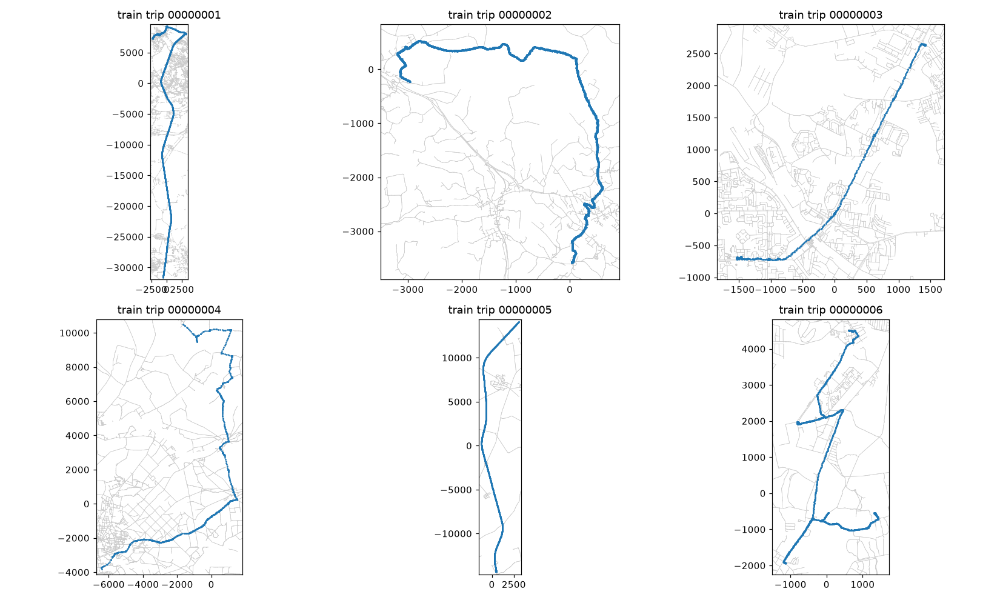<figcaption>Figure A1. Six TRAIN trajectories over their road networks.</figcaption></figure>


<figure>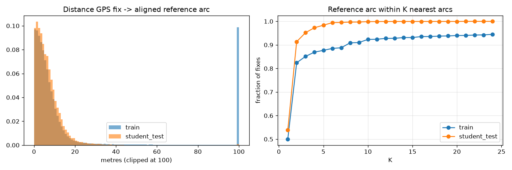<figcaption>Figure A2. Fix-to-reference-arc distance and rank of the reference arc among the nearest arcs.</figcaption></figure>


<figure>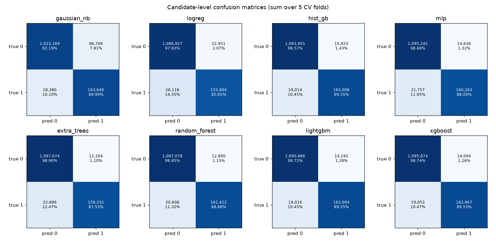<figcaption>Figure A3. Candidate-level confusion matrices summed over the 5 CV folds.</figcaption></figure>


<figure>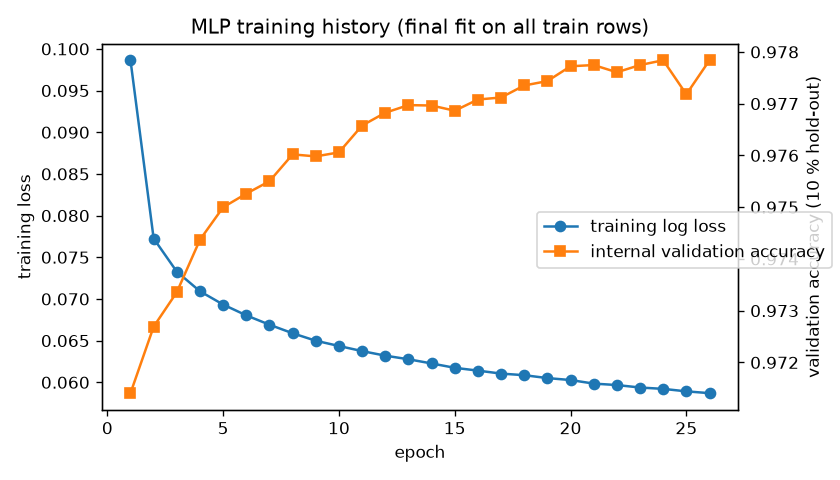<figcaption>Figure A4. MLP training history (the only model with epoch-wise curves).</figcaption></figure>


<figure>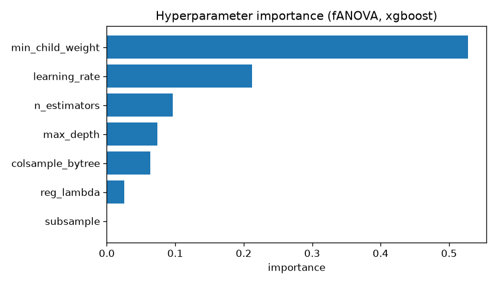<figcaption>Figure A5. Optuna hyperparameter importance.</figcaption></figure>


<figure>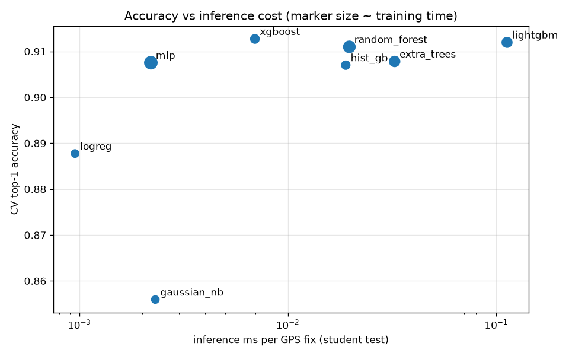<figcaption>Figure A6. Accuracy versus inference cost per model.</figcaption></figure>


### 22.6 Statement on AI assistance
In line with the hackathon's academic-integrity rules, the team discloses the following. AI coding assistants were used during
development of the backend, ML pipeline, tests and documentation, and of the frontend. They also helped draft this report. All
reported numbers were produced by executing the code in this repository and are read programmatically from the result files named
under each table.

### 22.7 Traceability
| Result | Source file |
|---|---|
| Dataset statistics | `reports/eda_summary.json`, `reports/eda_trip_stats.csv` |
| Model comparison, folds | `reports/experiments/model_comparison.csv`, `cv_folds.csv` |
| Optuna | `reports/experiments/optuna_xgboost_best.json`, `optuna_xgboost_trials.csv` |
| Tuned vs default | `reports/experiments/tuned_vs_untuned.csv` |
| HMM tuning | `reports/experiments/hmm_tuning.json`, `artifacts/final/hmm_params.json` |
| Student-test | `reports/experiments/route_eval_student_test*.csv/json` |
| Evaluator-test | `reports/evaluator/evaluator_results.csv/json` |
| Performance | `reports/experiments/benchmark.json` |
| Tests | `reports/final/evidence/*.txt`, `reports/integration/e2e_summary_evaluator.json` |
