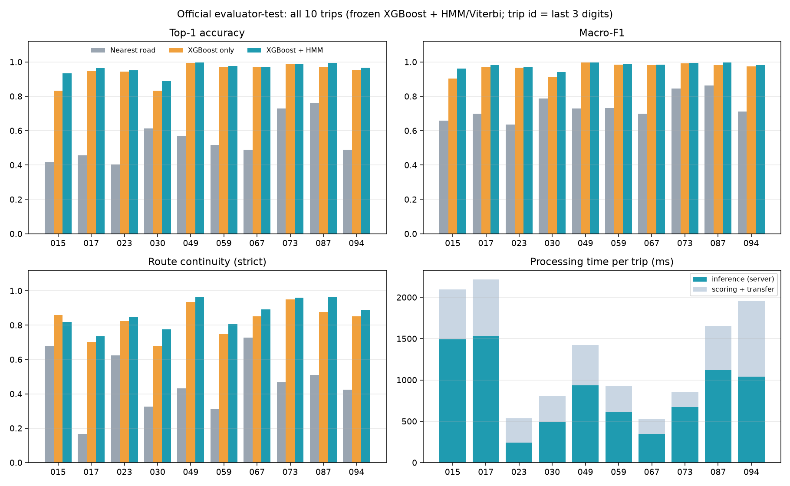
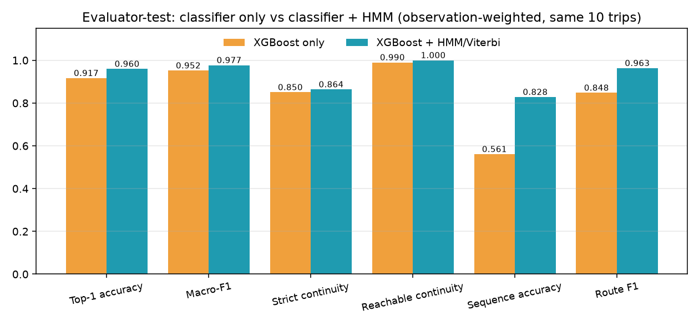

# PathSnap — Final evaluation on the official evaluator-test partition

*Generated by `reports/final/summarize_evaluator.py` from `reports/final/evaluator_all_trips.csv` (run through the live API,
`integration/run_evaluator.py`). Model: frozen XGBoost (tuned) + HMM/Viterbi (`artifacts/final/`, model.joblib sha256 `7ebb199fc9b56a3d…`).*

## Dataset validation
10 trip folders, **10 valid** (all of .track/.nodes/.arcs present and readable, no NaN or invalid coordinates,
increasing timestamps, valid node references; .route present for server-side scoring). The folder contains **no scoring scripts or
documentation**. Scoring follows the hackathon guidelines: the API computes metrics server-side after prediction.

## Run
Trips evaluated: **10** · successful: **10** · failed: **0** ·
GPS observations processed: **19,674** · total evaluation runtime: **13.24 s**.
HMM status: ok = 10.

## Per-trip results (XGBoost + HMM/Viterbi)

| Trip | GPS fixes | Route arcs | Top-1 acc. | Macro prec. | Macro rec. | Macro-F1 | Log loss | Strict continuity | Seq. acc. | Route prec. | Route rec. | Route F1 | Cand. miss | Inference ms | Total ms | HMM |
|---|---|---|---|---|---|---|---|---|---|---|---|---|---|---|---|---|
| 00000015 | 6,854 | 227 | 93.29 % | 0.9608 | 0.9615 | 0.9612 | 0.1436 | 81.77 % | 59.03 % | 83.30 % | 99.11 % | 90.52 % | 0.18 % | 1,492 | 2,096 | ok |
| 00000017 | 1,346 | 855 | 96.29 % | 0.9798 | 0.9830 | 0.9814 | 0.0343 | 73.50 % | 92.63 % | 97.64 % | 99.85 % | 98.73 % | 0.74 % | 1,535 | 2,218 | ok |
| 00000023 | 458 | 96 | 95.20 % | 0.9710 | 0.9726 | 0.9718 | 0.0575 | 84.48 % | 61.46 % | 95.32 % | 100.00 % | 97.61 % | 0.44 % | 239 | 537 | ok |
| 00000030 | 654 | 355 | 88.84 % | 0.9388 | 0.9413 | 0.9400 | 0.1071 | 77.60 % | 92.96 % | 96.11 % | 98.95 % | 97.51 % | 0.61 % | 493 | 806 | ok |
| 00000049 | 2,642 | 409 | 99.58 % | 0.9974 | 0.9974 | 0.9974 | 0.0109 | 96.18 % | 99.76 % | 100.00 % | 99.88 % | 99.94 % | 0.00 % | 935 | 1,425 | ok |
| 00000059 | 1,031 | 488 | 97.58 % | 0.9866 | 0.9874 | 0.9870 | 0.0227 | 80.46 % | 93.24 % | 98.88 % | 100.00 % | 99.44 % | 0.19 % | 612 | 925 | ok |
| 00000067 | 916 | 82 | 97.16 % | 0.9832 | 0.9832 | 0.9832 | 0.0504 | 89.04 % | 100.00 % | 100.00 % | 100.00 % | 100.00 % | 0.00 % | 347 | 529 | ok |
| 00000073 | 1,144 | 240 | 98.86 % | 0.9935 | 0.9935 | 0.9935 | 0.0132 | 96.05 % | 99.17 % | 99.80 % | 100.00 % | 99.90 % | 0.00 % | 673 | 852 | ok |
| 00000087 | 1,399 | 454 | 99.50 % | 0.9971 | 0.9971 | 0.9971 | 0.0288 | 96.57 % | 99.78 % | 100.00 % | 99.54 % | 99.77 % | 0.00 % | 1,116 | 1,652 | ok |
| 00000094 | 3,230 | 635 | 96.69 % | 0.9812 | 0.9812 | 0.9812 | 0.0382 | 88.77 % | 94.96 % | 99.19 % | 99.72 % | 99.45 % | 0.00 % | 1,042 | 1,956 | ok |

*Total ms = complete `POST /evaluation/run` round trip (prediction + server-side scoring + transfer). Log loss is that of the
classifier probabilities (the HMM does not change them).*

## Overall results and XGBoost-only vs XGBoost + HMM (same 10 trips)

| Metric | Nearest road (obs-weighted) | XGBoost only (obs-weighted) | **XGB + HMM (obs-weighted)** | XGBoost only (macro-avg) | **XGB + HMM (macro-avg)** |
|---|---|---|---|---|---|
| Top-1 accuracy | 50.91 % | 91.66 % | **95.96 %** | 93.97 % | **96.30 %** |
| Macro-F1 | 0.7140 | 0.9520 | **0.9771** | 0.9660 | **0.9794** |
| Macro precision | 0.7139 | 0.9517 | **0.9768** | 0.9656 | **0.9790** |
| Macro recall | 0.7141 | 0.9523 | **0.9774** | 0.9664 | **0.9798** |
| Route continuity (strict) | 51.36 % | 85.04 % | **86.37 %** | 82.69 % | **86.44 %** |
| Network-reachable continuity | 95.14 % | 99.02 % | **100.00 %** | 98.32 % | **100.00 %** |
| Sequence accuracy | 25.04 % | 56.09 % | **82.81 %** | 71.16 % | **89.30 %** |
| Route precision | 52.78 % | 78.63 % | **93.58 %** | 90.57 % | **97.02 %** |
| Route recall | 79.73 % | 97.93 % | **99.55 %** | 96.82 % | **99.70 %** |
| Route F1 | 62.51 % | 84.79 % | **96.32 %** | 92.68 % | **98.29 %** |
| Candidate miss rate | 0.15 % | 0.15 % | **0.15 %** | 0.22 % | **0.22 %** |
| Log loss | n/a | 0.0714 | **0.0714** | 0.0507 | **0.0507** |

**Aggregation.**
- **Observation-weighted** = Σ(metric × GPS fixes) / Σ GPS fixes. For top-1 accuracy this is the pooled accuracy over all 19,674 fixes.
- **Macro-average** = the unweighted mean of the 10 per-trip values.
- The evaluator defines no official aggregate, so both are reported.

The nearest-road log loss is n/a (no probabilities).

## Timing
- Inference: mean 848.4 ms, range 238.7–1,534.7 ms.
- HMM: mean 240.6 ms.
- Total per trip (round trip): mean 1,299.8 ms.
- Fastest: 00000067 (529 ms, 916 fixes). Slowest: 00000017 (2,218 ms, 1,346 fixes).

## Best / worst
Best accuracy: 00000049 (99.58 %). Worst: 00000030 (88.84 %).
The HMM improved top-1 accuracy on 10 of 10 trips. It lowered strict continuity on:
00000015.

## Integrity
- The model was trained and tuned on TRAIN only. The HMM was tuned on TRAIN out-of-fold predictions; none of its 24 tuning trips is an evaluator trip.
- Evaluator data was used only for this measurement.
- Prediction reads .track/.nodes/.arcs only. The .route file is read server-side after prediction, and no ground truth is returned.
- Reproducibility: identical metrics to the first official run (reports/evaluator/evaluator_results.csv): max abs difference 0.0 over 66 metric columns.

